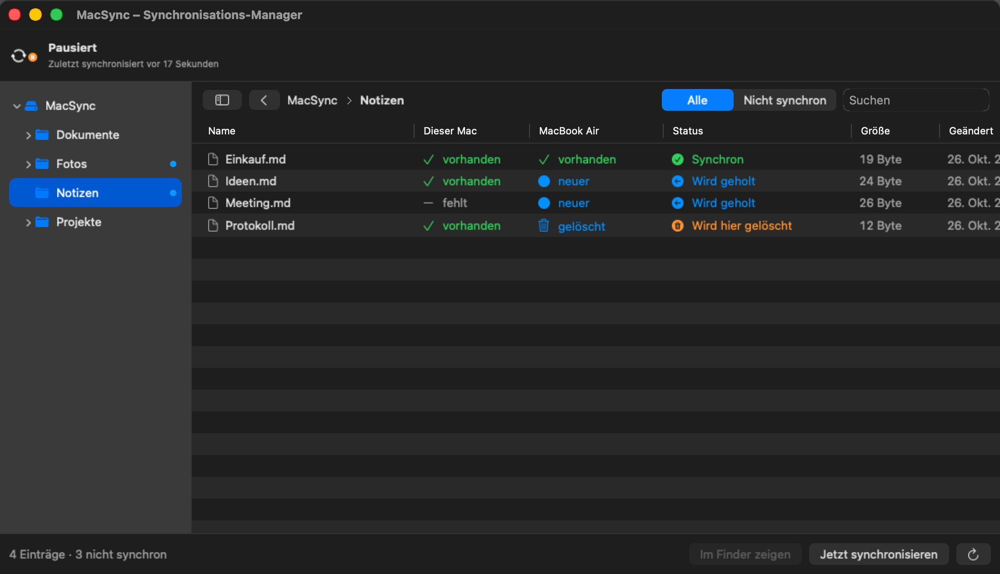
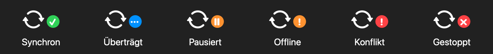
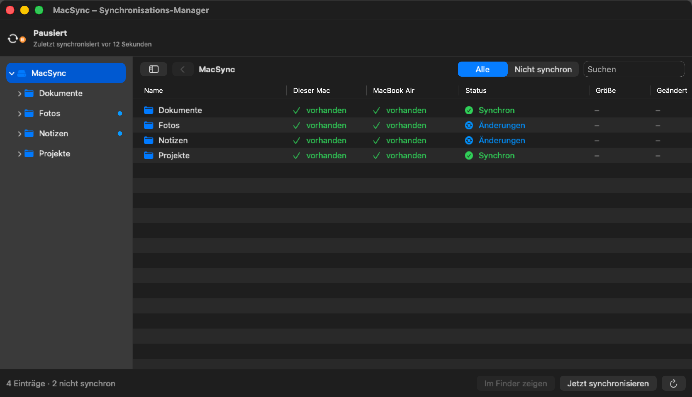

<p align="center">
  
</p>

<h1 align="center">MacSync</h1>

<p align="center">
  <b>Zwei Macs, ein Stand.</b> Git-bewusste, bitgenaue Synchronisation im lokalen Netz –
  inklusive <code>.git</code>, <code>node_modules</code> und nicht committeter Arbeit.<br>
  Ohne Cloud, ohne Konto, ohne je einen Commit, Branch oder Stash zu erzeugen.
</p>

<p align="center">
  <a href="https://github.com/chrisurf/MacSync/releases/latest">Download (Apple Silicon)</a> ·
  <a href="MAKE-HELP.md">Kurzanleitung</a> ·
  <a href="docs/getting-started-mac.md">Getting Started</a> ·
  <a href="CHANGELOG.md">Änderungen</a>
</p>

---

<p align="center">
  
</p>

## Was MacSync macht

- **Ganze Projektordner synchron halten** – mit Git-Repositories, Abhängigkeiten,
  ignorierten Dateien und allem, was nicht committet ist. Ideal, um zwischen
  MacBook und Mac Studio zu wechseln und genau dort weiterzuarbeiten.
- **Git-bewusst:** erfasst wird nur, wenn Git ruht; angewendet wird in
  Git-Reihenfolge (Objekte → Refs → `HEAD` → Arbeitsbaum → `index`). Kein
  halber Stand, kein kaputtes Repository.
- **Sicher:** Kopplung per 6-stelligem Code (SPAKE2), Ende-zu-Ende-verschlüsselt
  (Noise), ausschliesslich im lokalen Netz. Keine Cloud, kein Server.
- **Nichts geht verloren:** Konflikte werden nie still aufgelöst; überschriebene
  und gelöschte Dateien landen 14 Tage im MacSync-Papierkorb.

## Die App

Nach der Installation lebt MacSync in der **Menüleiste**. Das Symbol zeigt den
Zustand auf einen Blick, die Pfeile drehen sich, solange übertragen wird:

<p align="center">
  
</p>

Der **Synchronisations-Manager** (Menü → Synchronisations-Manager …, ⌘M) zeigt
jede Datei mit ihrem Zustand auf **diesem Mac** und dem **anderen Mac** –
synchron, wird gesendet, wird geholt, wird gelöscht oder Konflikt. Links der
Verzeichnisbaum, oben der Fortschritt mit Restzeit:

<p align="center">
  
</p>

Pro Datei oder Ordner: **Jetzt synchronisieren**, **Pausieren** (Hauptordner),
**Konflikt lösen**, **Im Finder zeigen**, **In den Papierkorb**.

## Installation

1. Auf **beiden** Macs `MacSync-<version>-arm64.pkg` aus den
   [Releases](https://github.com/chrisurf/MacSync/releases/latest) laden und
   doppelklicken – MacSync landet in `/Programme`.
2. Meldet macOS „nicht verifiziert“: Systemeinstellungen → Datenschutz &
   Sicherheit → **Trotzdem öffnen**. Bei der Frage nach dem lokalen Netzwerk
   → **Erlauben**.
3. Der Einrichtungsassistent führt durch drei Schritte: Ordner wählen →
   auf einem Mac „Dieser Mac wartet“, auf dem anderen den Mac auswählen und
   den Code eingeben → fertig.

Voraussetzungen: macOS 14 oder neuer, Apple Silicon (M1–M4), beide Macs im
selben Netzwerk.

**Update von RepoSync (≤ 0.2):** einfach installieren – Konfiguration,
Kopplung und Datenbank werden beim ersten Start übernommen
([ADR-0011](docs/adr/0011-umbenennung-macsync.md)). Beide Macs aktualisieren;
Versionen vor und nach 0.3.0 verbinden sich nicht miteinander.

## Im Terminal

Alles, was die App kann, geht auch im Terminal – das Werkzeug `macsync`
(in der App enthalten; Menü → Einstellungen → „Werkzeug installieren“):

```sh
macsync status                 # Zustand beider Seiten
macsync browse Notizen         # Dateien eines Ordners mit Zustand
macsync conflicts              # offene Konflikte
macsync log --since 1h         # was passiert ist und warum
macsync-connect ~/MacSync      # zwei Macs ohne App verbinden
```

Aus dem Quellcode bauen:

```sh
xcode-select --install                                          # einmalig
curl --proto '=https' --tlsv1.2 -sSf https://sh.rustup.rs | sh  # einmalig (oder: brew install rustup)
git clone https://github.com/chrisurf/MacSync.git && cd MacSync
make doctor        # prüft Voraussetzungen
make install-app   # baut MacSync.app und installiert sie
make install       # nur das Werkzeug macsync nach ~/.local/bin
```

Alle Befehle: `make help` · Kurzanleitung: [MAKE-HELP.md](MAKE-HELP.md)

## Wo liegt was

| Ort | Inhalt |
| --- | --- |
| `/Applications/MacSync.app` | App (enthält das Werkzeug `macsync`) |
| `~/.config/macsync/config.toml` | Konfiguration |
| `~/Library/Application Support/MacSync/` | Geräteschlüssel, Kopplung, Datenbank |
| `<Sync-Ordner>/.macsync/` | Zwischenablage und Papierkorb (wird nie synchronisiert) |
| `~/Library/Logs/MacSync/daemon.log` | Protokoll |

## Dokumentation

| Dokument | Inhalt |
| --- | --- |
| [MAKE-HELP.md](MAKE-HELP.md) | Kurzanleitung: verbinden, stoppen, Hilfe |
| [docs/getting-started-mac.md](docs/getting-started-mac.md) | Test auf zwei Macs im eigenen WLAN – Schritt für Schritt |
| [docs/sync-manager.md](docs/sync-manager.md) | Synchronisations-Manager, Fortschritt, Status-Symbol |
| [docs/operations.md](docs/operations.md) | Konfiguration, Bedienung, Fehlerbehebung |
| [docs/architecture.md](docs/architecture.md) | Crates, Datenmodell, Protokoll, Abläufe |
| [docs/concept.md](docs/concept.md) | Originalkonzept |
| [docs/implementation-plan.md](docs/implementation-plan.md) · [docs/app-plan.md](docs/app-plan.md) | Pläne und Meilensteine |
| [docs/maintenance.md](docs/maintenance.md) | Abhängigkeiten, Toolchain, Sicherheitsmeldungen |
| [docs/validation-report.md](docs/validation-report.md) | Testergebnisse und Messwerte |
| [docs/adr/](docs/adr/) | Architekturentscheidungen |

## Entwicklung

```sh
make check         # lint + test + audit (wie die CI)
make e2e           # zwei echte Daemons auf diesem Rechner
make app           # build/MacSync.app
make pkg           # build/MacSync-<version>-arm64.pkg
make screenshots   # Bilder dieser README mit Demo-Daten neu erzeugen
```

Rust-Kern (Daemon, Protokoll, CLI) und SwiftUI-App; Toolchain gepinnt in
`rust-toolchain.toml`, Abhängigkeiten in `Cargo.lock`. Ein Merge auf `main`
mit neuer Version erzeugt automatisch ein Release mit Installer
([release.yml](.github/workflows/release.yml)).

---

<p align="center">
  Entwickelt von <a href="https://alpineperspective.com">Alpine Perspective GmbH</a>
</p>
