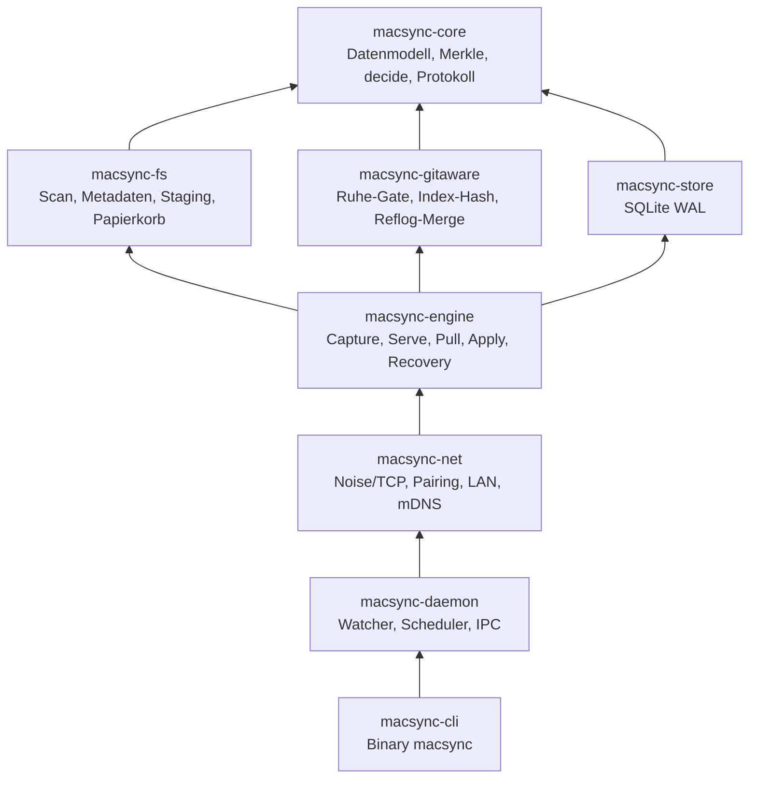
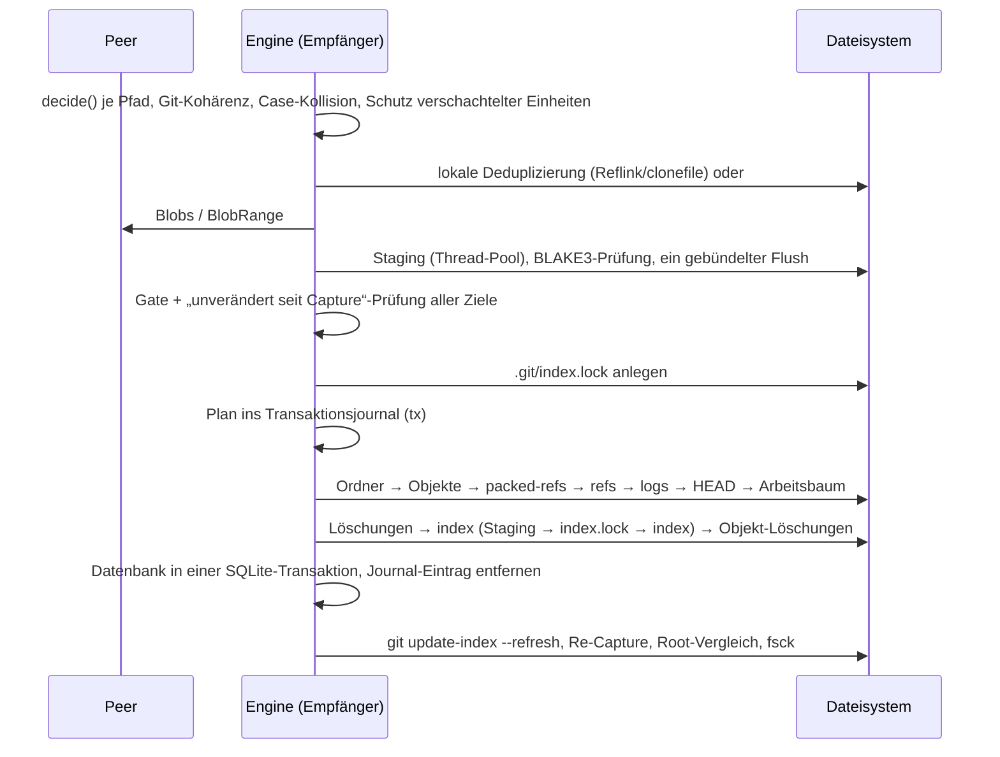

# Architektur der Umsetzung (MVP v0.1)

Dieses Dokument beschreibt, *wie* das [Konzept](concept.md) umgesetzt ist.
Begründungen für Abweichungen stehen in den [ADRs](adr/).

## Crates

| Crate | Wichtigste Typen / Funktionen |
| --- | --- |
| `core` | `Entry` (blob- und cmp-Hash, Modus, xattrs, Flags, Hardlink, Tombstone, `VersionVector`), `Tree` (Merkle), `decide()`, `GitClass`, `proto::{Request, Response}` |
| `fs` | `scan_unit`, `top_level_units`, `meta::{read,write}_xattrs`, `ops::{hash_file, read_verified, clone_or_copy, move_to_trash, sync_paths}` |
| `gitaware` | `Gate::check`, `index::semantic_hash`, `reflog::merge`, `cmd::{refresh_index, fsck_connectivity}` |
| `store` | `Store` mit Tabellen `units`, `entries`, `tx`, `journal`, `conflicts`, `peers`, `kv` |
| `engine` | `Engine::{scan_unit, scan_all, verify, sync_from, pull_unit, resolve, recover, handle}`, Trait `PeerApi` |
| `net` | `SecureStream` (Noise XX), `Server`, `NetPeer: PeerApi`, `pairing::{listen, connect}`, `lan::is_local`, `discovery` |
| `daemon` | `Config`, `Node`, `Daemon` (Threads), `ipc` (JSON über Unix-Socket), `service` |

## Einheiten

* jedes Verzeichnis direkt unter der Wurzel → Ordner- oder Git-Einheit
  (Git, wenn `.git`-Ordner oder `.git`-Datei existiert)
* verschachtelte Repositories → eigene Einheiten (`clients/acme`); die
  Eltern-Einheit „vergisst“ deren Pfade (keine Tombstones)
* lose Dateien im Wurzelverzeichnis → Einheit `.`
* jede Einheit hat einen Wurzel-Eintrag `""`, damit auch die Löschung einer
  ganzen Einheit übertragen wird
* `git init` / Löschen von `.git` ändert nur den Typ; Versionsvektoren bleiben

## Erfassung (Capture)

1. Ruhe-Gate (Git-Einheiten): Lock-Dateien, Mehrschritt-Operationen,
   laufende `git`-Prozesse im Arbeitsverzeichnis.
2. Scan ohne Symlink-Folgen; Stat-Cache (Grösse, `mtime`, Inode, Gerät,
   `ctime`, Modus) entscheidet, ob gehasht wird.
3. `.git/index` erhält einen semantischen Vergleichs-Hash (ADR-0008).
4. Zustandsänderung → eigener VV-Zähler +1; verschwundene Einträge →
   Tombstone mit VV +1.
5. Optimistischer Snapshot (ADR-0005): Hat sich die Einheit während des Scans
   geändert oder ist das Gate zu, wird nichts geschrieben.

## Protokoll (empfängergesteuert)

| Schritt | Anfrage | Antwort |
| --- | --- | --- |
| Verbindung | Noise-XX-Handshake, Schlüssel gepinnt, `Hello` (Protokollversion, Geräte-ID, Architektur, Root-Pfad) | `Hello` |
| Vergleich | `Roots` | Root-Hash je Einheit |
| Abstieg | `Tree{unit, dirs}` (bis 512 Ordner je Anfrage) | Kinder `(Name, Typ, Hash)` |
| Einträge | `Entries{unit, paths, prefixes}` | Einträge inkl. Tombstones und VV |
| Inhalte | `Blobs{hashes}` (≤ 8 MB / 4096 Dateien) bzw. `BlobRange` (4 MB) | Bytes, gegen Hash geprüft, sonst `None` |
| Hinweis | `Changed{units}` | – (Empfänger zieht nach Ruhe) |

Logische Nachrichten ab 4 KiB werden mit zstd komprimiert, wenn das kleiner ist.

## Anwendung (Apply)

* Vor jedem Überschreiben wird die alte Version per Hardlink (O(1)) in
  `<root>/.macsync/trash/<tx>/` gesichert; Löschungen werden dorthin verschoben.
* Ein Ordner, der nach dem Löschen seiner bekannten Kinder nicht leer ist
  (nicht synchronisierte Dateien), bleibt erhalten.
* Schlägt `git fsck --connectivity-only` fehl, werden in dieser Transaktion
  gelöschte Objekte aus dem Papierkorb zurückgelegt.
* Absturz: `Engine::open` → `recover()` führt Transaktionen im Zustand
  `applying` idempotent zu Ende (Staging bleibt bis dahin erhalten).

## Entscheidungen und Konflikte

Siehe Tabelle in [implementation-plan.md §3.3](implementation-plan.md#33-entscheidungsmatrix-coredecide).
Ergänzend:

* Objekte, flüchtige Git-Dateien und Ordner-Metadaten: deterministischer
  Tie-Break (grösserer Zustands-Hash) – beide Seiten konvergieren ohne Konflikt.
* Reflogs: zeilenweise Vereinigung, sortiert nach Zeitstempel.
* `HEAD`, Refs, `packed-refs`, Reflogs, Index bilden eine Kohärenzgruppe:
  ein Konflikt darin hält die ganze Gruppe als *einen* Konflikt (`git-state`)
  zurück; Objekte werden trotzdem vereinigt, damit der fremde Commit lokal
  inspiziert/gemergt werden kann.
* Konflikte landen in `<state_dir>/conflicts/<unit>/<tx>/…`, werden
  dedupliziert und geschlossen, sobald ein neuerer Stand sie überholt oder
  beide Seiten identisch sind.
* Richtungsvorgabe pro Einheit (`prefer local|remote`) und Spiegel-Modi lösen
  nebenläufige Änderungen automatisch.

## Daemon

| Thread | Aufgabe |
| --- | --- |
| Watcher | `notify` (FSEvents/inotify); Lesezugriffe werden ignoriert; Pfad → Einheit (längster Präfix) → `dirty` |
| Scheduler (100 ms) | Capture nach Ruhezeit (400 ms, bei > 200 Ereignissen/s 5 s, spätestens nach 30 s), `Changed` an Peer, Pull gemeldeter Einheiten, Anti-Entropie alle 60 s, Vollprüfung alle 24 h, stündliches Housekeeping |
| Server | ein Thread je Verbindung, nur gepaarte Schlüssel, nur lokale Adressen |
| IPC | `<state_dir>/daemon.sock` (0600), JSON-Zeilen: `status`, `sync`, `pause`, `resume`, `prefer`, `resolve`, `verify`, `rescan` |

## Sicherheit

* Pairing per SPAKE2 mit 6-stelligem Code, MAC-gesicherter Austausch der
  statischen Schlüssel, maximal 3 Versuche (ADR-0006).
* Transport: Noise XX, beidseitig gepinnte X25519-Schlüssel; fremde oder
  gefälschte Schlüssel werden abgelehnt (getestet).
* Nur Loopback, RFC 1918, Link-Local und ULA; öffentliche Ziele werden weder
  angenommen noch angewählt.
* Alle Pfade vom Peer werden validiert (`..`, absolute Pfade, `.git` in
  Einheitennamen, privates Verzeichnis); Inhalte werden vor dem Einsetzen
  gegen BLAKE3 geprüft; Hooks werden übertragen, nie ausgeführt, und im
  Journal gemeldet.

## Persistenz

| Ort | Inhalt |
| --- | --- |
| `~/.config/macsync/config.toml` | Konfiguration |
| `<state_dir>/macsync.db` | SQLite (WAL) |
| `<state_dir>/identity.key` | X25519-Schlüsselpaar (0600) |
| `<state_dir>/conflicts/` | fremde Versionen bei Konflikten |
| `<root>/.macsync/staging/` | Staging je Transaktion |
| `<root>/.macsync/trash/` | Papierkorb (14 Tage) |
