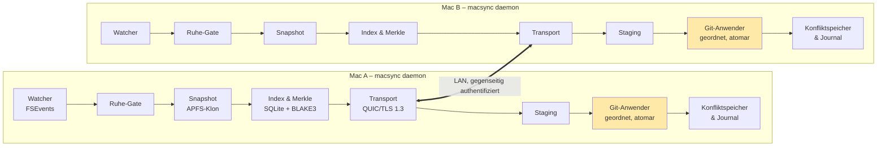

> Originalkonzept (Stand 20.10.2026). Abweichungen der MVP-Umsetzung sind in
> [`implementation-plan.md`](implementation-plan.md) und den [ADRs](adr/) dokumentiert.

# MacSync – Konzept für Git-bewusste LAN-Synchronisierung zwischen zwei Macs

Oct 20, 2026 · @Chris

## Zusammenfassung

MacSync ist ein Daemon für zwei Macs, der ein Wurzelverzeichnis mit Git-Repositories und gewöhnlichen Ordnern ohne Git bitgenau über das lokale WLAN spiegelt – inklusive `.git`, `node_modules` und aller übrigen Dateien – ohne je einen Commit, Branch oder Stash zu erzeugen.

Bestehende Tools scheitern, weil sie ein Repository als Sammlung unabhängiger Dateien behandeln. Ein Repo ist aber ein Zustand, dessen Dateien untereinander konsistent sein müssen. MacSync behandelt deshalb jedes Repo als **Transaktionseinheit**: Es wird nur in einem ruhigen, konsistenten Zustand erfasst und auf der Gegenseite ganz oder gar nicht angewendet.

Die sechs Kernprinzipien:

1. **Repo = Transaktion.** Kein Halbzustand ist je auf der Zielseite sichtbar.
2. **Erst Ruhe, dann Snapshot.** Erfasst wird nur, wenn Git nicht arbeitet und das Dateisystem still ist; eingefroren wird per APFS-Klon.
3. **Inhaltsadressierung überall.** BLAKE3-Hashes und Merkle-Bäume machen Gleichheit beweisbar und Drift sofort sichtbar.
4. **Git-bewusste Reihenfolge.** Objekte vor Refs, Refs vor `HEAD`, `index` zuletzt.
5. **Nie stille Datenverluste.** Lokale Änderungen werden nie überschrieben; Konflikte werden ausserhalb des Repos abgelegt und angezeigt.
6. **Nur LAN, beidseitig authentifiziert.** Kein Internet, kein Relay, kein Cloud-Konto.

## Problemanalyse

Alle gängigen Tools brechen an denselben drei Stellen: fehlende Atomarität pro Repo, falsche Reihenfolge in `.git` und Ineffizienz bei hunderttausenden kleinen Dateien.

| Tool | Ansatz | Warum es bei Git-Repos scheitert |
| --- | --- | --- |
| Syncthing | Dateiweiser Block-Sync, kontinuierlich | Mischt `.git`-Dateien beider Seiten → korrupte Repos, `index.sync-conflict`-Dateien; langsam bei `node_modules` ([Forum](https://forum.syncthing.net/t/resolving-sync-conflicts-in-git-folder/11969/4)) |
| Dropbox, iCloud, OneDrive | Cloud-Sync, dateiweise | Gleiche Inkonsistenz, dazu Internet-Abhängigkeit und Platzhalter-Dateien |
| Mutagen | Zweiweg-Sync für Dev-Umgebungen | Ignoriert oder propagiert `.git` als lose Dateien; keine Repo-Atomarität |
| Unison | Zweiweg-Sync, sehr schnell bei vielen kleinen Dateien | Läuft batchweise, nicht kontinuierlich; keine Git-Reihenfolge, keine Ruhe-Erkennung |
| rsync | Einweg-Kopie | Kopiert in Sortierreihenfolge: Refs können vor ihren Objekten ankommen; Abbruch hinterlässt Teilobjekte ([ostree-push](https://github.com/ssssam/ostree-push)) |
| git push/pull | Git-natives Protokoll | Überträgt nur Commits – nicht committete Arbeit, ignorierte Dateien und `node_modules` fehlen; erfordert Commits, die hier verboten sind |

**Ursache 1 – Atomarität.** Ein Git-Befehl ändert mehrere Dateien zusammen (Objekte, Ref, Reflog, Index). Ein Dateisync, der mitten in diese Folge greift, überträgt einen Zustand, den es nie gab.

**Ursache 2 – Selbständige Schreibvorgänge.** Git schreibt auch bei scheinbar lesenden Befehlen (`git status` aktualisiert den Index, Auto-GC packt Objekte um). Beide Macs erzeugen so Änderungen, obwohl der Nutzer nur auf einem arbeitet. Das ist die Hauptquelle von Drift.

**Ursache 3 – Kleine Dateien.** Bei `node_modules` (oft über 100'000 Dateien pro Projekt) sind Metadaten-I/O und Datenbankarbeit pro Datei der Engpass, nicht die Bandbreite.

## Anforderungen

Drei harte Randbedingungen bestimmen das ganze Design: alle Dateien, keine Commits, nur LAN.

**Harte Randbedingungen**

- **H1 Vollständigkeit:** Alle Dateien unterhalb des Wurzelverzeichnisses werden synchronisiert, inklusive `.git`, `node_modules`, Build-Ordner, ignorierter und versteckter Dateien. Ausschlüsse nur, wenn der Nutzer sie explizit konfiguriert. Das gilt gleichermassen für Git-Repositories und Ordner ohne Git sowie für jeden Dateityp und alle Metadaten, die macOS auf APFS kennt.
- **H2 Kein Eingriff in die Git-Historie:** Kein Commit, kein Branch, kein Stash, kein Tag, kein Ref im Repo wird vom Tool erzeugt. Jedes Repo behält seine Konventionen und Stände.
- **H3 Nur lokales Netzwerk:** Kein Internetzugriff, kein Relay, kein Cloud-Konto.

**Funktionale Anforderungen**

- F1: Auf beiden Macs ein Wurzelverzeichnis angeben; alle Unterverzeichnisse werden rekursiv gespiegelt.
- F2: Neue Repos und Ordner erscheinen automatisch auf der Gegenseite; Löschungen werden ebenfalls übertragen.
- F3: Kontinuierlicher Betrieb im Hintergrund mit Latenz von wenigen Sekunden nach dem Speichern.
- F4: Konflikte werden erkannt, nie still aufgelöst, sondern sichtbar abgelegt und mit einem Klick lösbar.
- F5: Drift wird aktiv erkannt und repariert, nicht nur passiv vermieden.
- F6: Pause, manueller Sync, Trockenlauf und Richtungsvorgabe ("dieser Mac gewinnt") pro Repo.

**Nicht-funktionale Anforderungen**

| Kriterium | Ziel |
| --- | --- |
| Latenz kleine Änderung | unter 3 s vom Speichern bis zur Anwendung |
| Leerlauf-Prüfung 1 Mio. Dateien | unter 1 s (Merkle-Root-Vergleich) |
| Erst-Sync | WLAN-Bandbreite weitgehend ausgeschöpft, auch bei kleinen Dateien |
| CPU im Leerlauf | nahe 0 %, ereignisgesteuert statt Polling |
| Integrität | kein Zustand ohne `git fsck`-Gültigkeit nach Anwendung |
| Absturzsicherheit | Abbruch an jeder Stelle hinterlässt den alten oder den neuen Zustand, nie einen Mischzustand |

## Architekturüberblick

Auf jedem Mac läuft derselbe Daemon; er erkennt Änderungen, wartet auf Ruhe, friert das Repo ein und überträgt es, während die Gegenseite empfängt, prüft und in Git-Reihenfolge einsetzt.

_Diagramm aus dem Original-Embed rekonstruiert (2 Macs, 8 Komponenten, 1 LAN-Verbindung)._

Der hervorgehobene Git-Anwender ist der entscheidende Unterschied zu allen bestehenden Tools: Er setzt `.git` nie dateiweise, sondern als geordnete Transaktion ein.

## Änderungserkennung und Ruhe-Erkennung

Ein Snapshot entsteht nur, wenn das Repo nachweislich ruht; so wird nie ein Zwischenzustand eines Git-Befehls übertragen.

**Änderungserkennung ohne Rescans**

- FSEvents auf das Wurzelverzeichnis mit Datei-Granularität (`kFSEventStreamCreateFlagFileEvents`).
- Die letzte verarbeitete Event-ID wird persistiert. Nach Neustart oder Ruhezustand liefert macOS alle verpassten Ereignisse seit dieser ID nach – kein Vollscan nötig.
- Meldet FSEvents `MustScanSubDirs` oder einen ID-Überlauf, wird nur der betroffene Teilbaum neu gescannt.
- Ein SQLite-Index speichert pro Datei Inode, Grösse, mtime, ctime, Modus und BLAKE3-Hash. Gehasht wird nur, wenn sich Metadaten geändert haben.
- Eigene Schreibvorgänge des Daemons werden über ein Echo-Register (Pfad + erwarteter Hash) erkannt und nicht zurückgespiegelt.

**Ruhe-Gate pro Repo** – ein Snapshot wird erst erzeugt, wenn alle Bedingungen erfüllt sind:

1. Keine Lock-Dateien in `.git`: `index.lock`, `HEAD.lock`, `refs/**/*.lock`, `packed-refs.lock`, `shallow.lock`.
2. Keine laufende Mehrschritt-Operation: kein `MERGE_HEAD`, `CHERRY_PICK_HEAD`, `REVERT_HEAD`, `BISECT_LOG`, kein `rebase-merge/` oder `rebase-apply/`. Während solcher Operationen wird das Repo weder erfasst noch beschrieben; `.git` bleibt unverändert, bis die Operation abgeschlossen ist.
3. Kein `git`-Prozess mit diesem Repo als Arbeitsverzeichnis (Prüfung per `proc_pidinfo`, Cache 500 ms).
4. Seit dem letzten FSEvent im Repo sind mindestens 400 ms vergangen (adaptiv: bei `npm install` bis 5 s, erkannt an hoher Ereignisrate in `node_modules`).

**Einfrieren per APFS-Klon**

Sobald das Gate offen ist, werden alle geänderten Dateien per `clonefile()` in einen Staging-Ordner auf demselben Volume geklont. Das ist Copy-on-Write: praktisch gratis, unabhängig von der Dateigrösse. Danach wird das Gate erneut geprüft; hat sich zwischenzeitlich etwas geändert, wird der Snapshot verworfen und neu versucht. Der Nutzer und Git arbeiten währenddessen ungestört weiter.

## Datenmodell

Jedes Repo wird durch ein Manifest beschrieben, dessen Merkle-Root den gesamten Zustand in 32 Bytes zusammenfasst; Versionsvektoren entscheiden, wer was zuletzt geändert hat.

**Einheiten**

- **Sync-Einheit:** jedes Repo (Ordner mit `.git`) und jeder Nicht-Repo-Ordner direkt unter der Wurzel. Verschachtelte Repos (Submodule, eingebettete Repos) sind eigene Einheiten.
- **Eintrag:** Datei, Ordner oder Symlink mit relativem Pfad, Typ, Modus, Grösse, mtime, Inhalts-Hash, Symlink-Ziel, Hardlink-Gruppe, Extended Attributes, Resource Fork, Finder-Info, ACL, BSD-Flags, Erstellungsdatum (Metadaten jeweils als Hash), Paket-Zugehörigkeit.

**Manifest und Merkle-Baum**

- Pro Ordner ein Knoten-Hash = BLAKE3 über die sortierten Einträge (Name, Typ, Modus, Inhalts-Hash bzw. Kind-Knoten-Hash).
- Die Wurzel des Baums ist der Zustands-Hash der Einheit. Gleiche Roots auf beiden Macs = bewiesen identisch.
- Bei Abweichung steigen beide Seiten nur in die Teilbäume mit unterschiedlichem Hash ab. Bei einer geänderten Datei in 1 Mio. Dateien werden so nur wenige Dutzend Knoten verglichen.
- `mtime` geht nicht in den Hash ein, sonst würde jedes `touch` als Inhaltsänderung gelten; sie wird separat übertragen.

**Versionsvektoren**

- Jeder Eintrag trägt einen Vektor `{MacA: n, MacB: m}`. Wer einen Eintrag ändert, erhöht seinen eigenen Zähler.
- Vergleich zweier Vektoren ergibt: gleich, A neuer, B neuer oder **nebenläufig** (= echter Konflikt). Uhrzeiten werden für Entscheidungen nie verwendet, da Uhren driften.
- Für Git-interne Pfade gelten Sonderregeln (siehe Git-bewusste Anwendung), weil viele davon konfliktfrei vereinigt werden können.

**Tombstones**

- Eine Löschung wird als Eintrag mit Status `deleted` und eigenem Versionsvektor gespeichert.
- Dadurch kann die Gegenseite eine gelöschte Datei nicht wiederbeleben, nur weil sie sie noch hat.
- Tombstones werden erst entfernt, wenn beide Seiten sie bestätigt haben, frühestens nach 30 Tagen.

**Persistenz**

SQLite im WAL-Modus unter `~/Library/Application Support/MacSync/`: Tabellen `units`, `entries`, `nodes`, `peers`, `journal`, `conflicts`. Inhalte selbst werden nicht doppelt gespeichert; der Daemon liest immer aus dem Arbeitsverzeichnis bzw. dem Staging-Klon.

## Übertragungsprotokoll und Performance

Das Protokoll vergleicht zuerst Hashes, überträgt dann nur fehlende Inhalte und bündelt kleine Dateien zu grossen Strömen – so wird die WLAN-Bandbreite auch bei `node_modules` ausgeschöpft.

**Ablauf einer Synchronisierungsrunde**

1. **Announce:** Die Quelle sendet `(Einheit, Root-Hash, Snapshot-ID)` für jede geänderte Einheit.
2. **Reconcile:** Das Ziel vergleicht Merkle-Knoten von oben nach unten und antwortet mit den abweichenden Pfaden.
3. **Have/Want:** Für jeden abweichenden Eintrag prüft das Ziel per Hash, ob es den Inhalt bereits irgendwo lokal besitzt (andere Datei, anderes Repo). Nur unbekannte Hashes werden angefordert.
4. **Transfer:** Die Quelle streamt die Inhalte aus ihrem eingefrorenen Staging-Klon.
5. **Commit:** Das Ziel wendet die Einheit atomar an und bestätigt mit dem neuen Root-Hash. Stimmt er nicht mit dem Root der Quelle überein, wird die Runde wiederholt.

**Optimierungen für viele kleine Dateien**

- **Bündelung:** Dateien unter 256 KB werden in Pakete von ca. 8 MB gepackt (einfaches Framing: Pfad-ID, Länge, Daten). Ein Paket = ein Netzwerk-Schreibvorgang statt tausender.
- **Kompression:** zstd Stufe 1–3 pro Paket; JavaScript-Quelltexte schrumpfen typischerweise auf ein Viertel. Bereits komprimierte Formate (Bilder, `.gz`, Packfiles) werden erkannt und roh gesendet.
- **Parallelität:** 4–8 QUIC-Streams pro Verbindung; grosse Dateien und Pakete laufen nebeneinander, ohne sich gegenseitig zu blockieren.
- **Lokale Deduplizierung:** Kennt das Ziel einen Hash bereits, erzeugt es die Datei per `clonefile()` aus der vorhandenen Kopie – null Übertragung, null zusätzlicher Speicher. Bei vielen Projekten mit ähnlichen Abhängigkeiten spart das den Grossteil von `node_modules`.
- **Paralleles Schreiben:** Auf der Zielseite schreibt ein Thread-Pool in den Staging-Ordner; `fsync` wird gebündelt pro Einheit statt pro Datei ausgeführt.

**Grosse Dateien**

- Dateien über 4 MB werden per Content-Defined Chunking (FastCDC, Zielgrösse 64 KB) zerlegt. Bei einer Änderung werden nur geänderte Chunks übertragen.
- Git-Packfiles werden nie verändert, nur neu erzeugt; sie werden daher als Ganzes übertragen, aber nur, wenn ihr Hash dem Ziel unbekannt ist.

**Erst-Synchronisierung**

Für den ersten Abgleich mehrerer hundert Gigabyte empfiehlt sich ein direkter Link per Thunderbolt-Kabel (Thunderbolt Bridge) oder Ethernet. Der Daemon erkennt automatisch die schnellste Schnittstelle zum Peer und bevorzugt sie.

## Git-bewusste atomare Anwendung

Die Zielseite schreibt alles zuerst in einen Staging-Ordner und setzt es dann in einer festen Git-Reihenfolge per atomarem `rename()` ein; Git sieht zu keinem Zeitpunkt einen inkonsistenten Zustand.

**Anwendungsreihenfolge**

1. **Vorbedingung prüfen:** Ruhe-Gate auch auf der Zielseite. Arbeitet dort gerade Git oder der Nutzer im selben Repo, wird gewartet oder ein Konflikt gemeldet.
2. **Lock setzen:** Der Daemon legt selbst `.git/index.lock` an. So blockiert jeder parallel gestartete Git-Befehl sauber mit der bekannten Meldung, statt halbe Zustände zu lesen.
3. **Objekte:** neue Loose Objects und Packfiles (`.pack` vor `.idx`, zuletzt `.rev`/`.bitmap`) einsetzen. Objekte sind inhaltsadressiert und unveränderlich, ihr Hinzufügen ist immer sicher.
4. **Refs:** `packed-refs`, dann `refs/**`, dann Reflogs.
5. **HEAD** und übrige Metadaten (`config`, `hooks/`, `info/`, `FETCH_HEAD`, `ORIG_HEAD`).
6. **Arbeitsbaum:** alle Dateien, Ordner, Symlinks; Löschungen zuletzt.
7. **Index:** zuletzt, durch Umbenennen des eigenen `index.lock` zu `index` – genau so, wie Git es selbst tut.
8. **Stat-Cache auffrischen:** `git update-index --refresh -q`. Der Index enthält maschinenspezifische Inode- und Zeitstempel; ohne Auffrischung würde `git status` beim nächsten Aufruf alles neu hashen. Dieser Schritt schreibt keine Historie.
9. **Verifizieren:** Root-Hash berechnen und mit der Quelle vergleichen; optional stichprobenartig `git fsck --connectivity-only`.

**Regeln für `.git`-Inhalte**

| Pfad | Regel |
| --- | --- |
| `objects/`, `objects/pack/` | Nur hinzufügen, nie per Sync löschen. Vereinigung ist immer konfliktfrei. |
| `refs/`, `packed-refs`, `HEAD` | Versionsvektor pro Ref; nebenläufige Änderung = Konflikt, lokaler Stand bleibt. |
| `index` | Folgt immer dem Gewinner von `HEAD` und Arbeitsbaum; wird nie einzeln gemischt. |
| `logs/` (Reflogs) | Zeilenweise Vereinigung nach Zeitstempel möglich, sonst wie Refs. |
| `config`, `hooks/`, `info/` | Normale Datei-Regeln mit Versionsvektor. |
| `*.lock`, `gc.pid`, `fsmonitor--daemon/` | Nie übertragen – rein prozesslokale Dateien. |

**Garbage Collection**

Weil Objekte per Sync nie gelöscht werden, könnte `.git/objects` langsam wachsen. MacSync löscht Packfiles nur dann auf beiden Seiten, wenn ein `git gc` auf einem Mac sie ersetzt hat **und** alle enthaltenen Objekte im neuen Pack nachweislich vorhanden sind. Optional kann `gc.auto=0` gesetzt und GC zeitgesteuert vom Daemon ausgelöst werden – das reduziert Drift durch Hintergrund-Wartung erheblich.

## Konflikt- und Drift-Management

Konflikte werden nach Klassen behandelt: was mathematisch konfliktfrei ist, wird automatisch vereinigt; alles andere bleibt lokal unverändert und wird ausserhalb des Repos sichtbar abgelegt.

**Konfliktklassen**

| Klasse | Erkennung | Automatische Behandlung | Nutzeraktion |
| --- | --- | --- | --- |
| Git-Objekte | gleicher Hash = gleicher Inhalt | Vereinigung | keine |
| Nur eine Seite geändert | Versionsvektor eindeutig | Übernahme | keine |
| Identische Änderung beidseitig | gleicher Inhalts-Hash | Vektoren zusammenführen | keine |
| Ref nebenläufig bewegt | Vektor nebenläufig | lokaler Ref bleibt; fremder Stand im Konfliktspeicher | Auswahl oder manuelles Merge |
| Arbeitsdatei beidseitig geändert | Vektor nebenläufig | lokale Version bleibt; fremde Version im Konfliktspeicher | Diff ansehen, Version wählen |
| Ändern vs. Löschen | Tombstone vs. neuere Änderung | Änderung gewinnt (Datenverlust vermeiden) | bestätigen |
| `node_modules` beidseitig geändert | Lockfile-Hash nebenläufig | als **ein** Konflikt auf Lockfile-Ebene gemeldet | Seite wählen; Ordner wird als Ganzes übernommen |
| Case-Kollision | `Foo.js` vs `foo.js` | nicht anwenden | umbenennen |

**Konfliktspeicher**

Fremde Versionen landen unter `~/Library/Application Support/MacSync/conflicts/<repo>/<zeitstempel>/` mit identischer Pfadstruktur. So verschmutzen sie weder `git status` noch das Projekt. Die Menüleisten-App zeigt pro Konflikt: Pfad, beide Versionen, Diff, wer wann geändert hat, und die Aktionen *Meine behalten*, *Andere übernehmen*, *Beide behalten*, *In Editor öffnen*.

**Kohärenz-Regel für Git-Zustand**

`HEAD`, Index und Arbeitsbaum eines Repos gehören zusammen. Gibt es in einem Repo einen Ref- oder `HEAD`-Konflikt, wird der gesamte Git-Zustand dieser Einheit als **ein** Konflikt behandelt und nicht teilweise übernommen. Damit entsteht nie ein Repo, dessen Index zu einem anderen Commit passt als `HEAD`.

**Aktive Drift-Erkennung (Anti-Entropie)**

- Alle 60 s tauschen die Peers die Root-Hashes aller Einheiten aus (wenige KB). Abweichung ohne laufende Synchronisierung = Drift.
- Drift wird über den normalen Reconcile-Ablauf repariert und im Journal mit Ursache protokolliert.
- Einmal täglich ein vollständiger Abgleich gegen den Dateisystemzustand (nicht nur gegen den Index), um verpasste FSEvents zu finden.
- Die Menüleiste zeigt pro Repo: *synchron (Hash)*, *wird übertragen*, *wartet auf Ruhe*, *Konflikt*, *Drift repariert*.

**Betriebsmodi**

- **Zweiweg (Standard):** beide Macs gleichberechtigt, Konflikte wie oben.
- **Übergabe:** Ein Mac ist aktiv; beim Wechsel (Bildschirm entsperrt, Tastatur benutzt) wird zuerst vollständig synchronisiert und erst dann die Führung übergeben. Empfohlen, wenn nie gleichzeitig gearbeitet wird – eliminiert praktisch alle Konflikte.
- **Spiegel:** strikt einseitig, z. B. für einen Backup-Mac.

## macOS-Besonderheiten

Bitgenaue Spiegelung auf macOS erfordert, dass das Tool Dateisystem-Details explizit erhält, die generische Sync-Tools oft verlieren.

| Thema | Risiko | Lösung |
| --- | --- | --- |
| Symlinks (`node_modules/.bin`, pnpm) | als Datei kopiert → Befehle brechen | als Symlink mit unverändertem Ziel übertragen, nie folgen |
| Hardlinks (pnpm-Store) | doppelter Speicher, gebrochene Verknüpfung | Hardlink-Gruppen erkennen (Inode + Gerät), auf Zielseite neu verlinken |
| Ausführungsrechte | Skripte nicht mehr ausführbar | vollständigen Modus übertragen |
| Extended Attributes | `com.apple.quarantine` blockiert Binaries | xattrs übertragen, Quarantäne-Attribut konfigurierbar entfernen |
| Unicode-Normalisierung | `ü` als NFC vs. NFD → Phantom-Dateien | Pfade intern normalisieren, Originalbytes erhalten |
| Gross-/Kleinschreibung | APFS meist case-insensitive | Kollisionen erkennen und als Konflikt melden |
| Native Module (`.node`, `esbuild`, `sharp`) | Architektur-Mismatch Intel vs. Apple Silicon | Architektur beim Pairing vergleichen; bei Unterschied warnen |
| Absolute Pfade (venv, Caches) | zeigen auf falschen Benutzerordner | gleicher Benutzername und Pfad empfohlen; Prüfung beim Pairing |
| Spotlight, Time Machine | zusätzliche Last bei Staging | Staging-Ordner mit `.metadata_never_index` und Time-Machine-Ausschluss |
| Ruhezustand | verpasste Ereignisse, abgebrochene Übertragung | FSEvents-ID-Replay, fortsetzbare Transfers, Wake-Erkennung |
| Berechtigungen | Zugriff auf Dokumente-Ordner verweigert | Full Disk Access bzw. gezielte Ordnerfreigabe beim Setup |

Standardausschlüsse (abschaltbar): `.DS_Store`, `.Spotlight-V100`, `.Trashes`, `.fseventsd`. Sie sind Mac-lokal und erzeugen sonst ständige Scheinänderungen.

## Ordner ohne Git und alle macOS-Dateitypen

MacSync synchronisiert jeden Ordner unterhalb der Wurzel, mit oder ohne Git, und jedes Dateisystemobjekt, das macOS auf APFS kennt – inklusive aller Metadaten.

**Zwei Arten von Sync-Einheiten**

| Einheit | Erkennung | Ruhe-Gate | Atomarität | Konflikte |
| --- | --- | --- | --- | --- |
| Git-Einheit | Ordner mit `.git`-Verzeichnis oder `.git`-Datei (Worktree, Submodul) | Git-Locks, Git-Prozesse, Dateisystem still | ganzes Repo als Transaktion, Git-Reihenfolge | Regeln für `.git` plus Datei-Regeln |
| Ordner-Einheit | jeder andere Ordner | Dateisystem still, Datei nicht geöffnet | pro Datei bzw. pro Paket | Versionsvektor pro Datei, Konfliktspeicher |

- Ordner-Einheiten durchlaufen dieselbe Pipeline (Watcher, Ruhe-Gate, Snapshot, Merkle-Reconcile, Staging, atomares `rename`) – nur ohne die Git-Schritte.
- Ein Ordner ohne Git innerhalb eines Repos gehört zur Git-Einheit; ein Repo innerhalb eines gewöhnlichen Ordners ist eine eigene Git-Einheit.
- Typwechsel werden erkannt: `git init` macht aus einer Ordner- eine Git-Einheit; wird `.git` gelöscht, wird das Repo zur Ordner-Einheit. Bestehende Versionsvektoren bleiben erhalten.
- Leere Ordner werden ebenfalls angelegt und gelöscht.

**Zusammengehörige Dateien ausserhalb von Git**

Auch ohne Git gibt es Dateien, die nur gemeinsam konsistent sind. Sie werden als Gruppe atomar übertragen:

- **Pakete/Bundles** (Ordner, die der Finder als eine Datei zeigt): `.app`, `.pages`, `.numbers`, `.key`, `.rtfd`, `.photoslibrary`, `.xcodeproj`, `.xcassets`, `.logicx`, `.band`, `.fcpbundle`, `.bundle`, `.framework`. Erkannt über die Paket-Eigenschaft von Launch Services, nicht nur über die Endung.
- **SQLite-Datenbanken** mit `-wal`- und `-shm`-Dateien: nur synchronisieren, wenn keine App sie geöffnet hat (Prüfung offener Dateideskriptoren), dann alle drei zusammen.
- **Dateien, die gerade geschrieben werden** (Downloads, Exporte, Office-Speicherungen mit Temp-Datei): erst übertragen, wenn sie geschlossen und still sind.

**Unterstützte Dateisystemobjekte und Metadaten**

| Objekt / Eigenschaft | Behandlung |
| --- | --- |
| Reguläre Dateien jeder Art und Endung | Inhalt bytegenau, egal ob Text, Binär, Medien, Archiv |
| Ordner, auch leere | angelegt mit Rechten und Metadaten |
| Symlinks | Ziel unverändert, auch relative und tote Links; nie gefolgt |
| Hardlinks | Gruppen erkannt und auf Zielseite neu verlinkt |
| Pakete/Bundles | atomar als Ganzes |
| Sparse Files (VM-Images, Datenbanken) | Löcher bleiben erhalten (`SEEK_HOLE`/`SEEK_DATA`) |
| APFS-Klone | auf Zielseite per `clonefile` nachgebildet, wo Inhalte gleich sind |
| Transparent komprimierte Dateien (`UF_COMPRESSED`) | Inhalt gelesen, auf Zielseite wieder komprimiert geschrieben |
| Extended Attributes | alle, inkl. Finder-Tags, Spotlight-Kommentare, `com.apple.metadata:*` |
| Resource Forks | als `com.apple.ResourceFork` übertragen |
| Finder-Info | Farbetiketten, Typ/Creator, "Erweiterung ausblenden" |
| Quarantäne-Attribut | übertragen oder entfernt, konfigurierbar |
| Rechte, Eigentümer, ACLs | Modus vollständig; ACLs optional |
| BSD-Flags | `hidden`, `uchg` (geschützt) u. a.; geschützte Dateien werden zum Schreiben entsperrt und danach wieder gesperrt |
| Zeitstempel | Änderungsdatum und Erstellungsdatum (`birthtime`); Zugriffszeit nicht |
| Finder-Aliase | als Datei mit Bookmark-Daten; können auf dem anderen Mac auf ein anderes Ziel zeigen |
| Sehr grosse Dateien (über 4 GB, Videos, Disk-Images) | Content-Defined Chunking, fortsetzbar |
| FIFOs | auf Zielseite neu angelegt (`mkfifo`) |
| Sockets, Gerätedateien | nicht übertragbar (prozesslokal); übersprungen und im Journal gemeldet |
| iCloud-Platzhalter (nicht geladene Dateien) | nicht anfassen, da Lesen einen Internet-Download auslösen würde; als "ausgelagert" gemeldet |

**Umsetzung**

- Schnelles Einlesen inklusive Erstellungsdatum, Flags und Paket-Erkennung per `getattrlistbulk`.
- Metadaten werden plattformneutral serialisiert und gehashed; so erkennt der Merkle-Baum auch reine Metadaten-Änderungen (z. B. neues Finder-Tag), ohne den Inhalt erneut zu übertragen.
- Auf der Zielseite schreibt `copyfile(3)` mit `COPYFILE_ALL` aus dem Staging-Klon; Erstellungsdatum und Flags folgen per `setattrlist`, danach atomares `rename`.

## Netzwerk, Pairing und Sicherheit

Die beiden Macs finden sich per Bonjour, vertrauen sich nach einmaligem Pairing über Ed25519-Schlüssel und sprechen ausschliesslich verschlüsseltes QUIC im lokalen Netz.

**Discovery**

- Bonjour/mDNS-Dienst `_macsync._udp.local` mit TXT-Eintrag (Geräte-ID-Hash, Protokollversion). Kein zentraler Server.
- Fallback: manuell eingetragene IP oder Hostname `.local`, z. B. bei Gäste-WLANs mit Client-Isolation.
- Mehrere Schnittstellen gleichzeitig (WLAN, Ethernet, Thunderbolt Bridge); die schnellste wird bevorzugt, Wechsel ohne Abbruch dank QUIC-Connection-Migration.

**Pairing**

1. Jeder Daemon erzeugt beim ersten Start ein Ed25519-Schlüsselpaar; der private Schlüssel liegt im macOS-Schlüsselbund.
2. Mac A zeigt einen 6-stelligen Code bzw. QR-Code; Mac B gibt ihn ein.
3. Über ein PAKE-Verfahren (z. B. SPAKE2) werden die öffentlichen Schlüssel ausgetauscht – sicher, ohne dass der kurze Code abgefangen werden kann.
4. Danach akzeptiert jeder Mac nur noch Verbindungen vom gepaarten Schlüssel.

**Transport**

- QUIC (TLS 1.3) mit gegenseitiger Authentifizierung über die Raw Public Keys; kein Zertifikat einer externen Stelle nötig.
- Lokal-only-Erzwingung: Der Daemon bindet nur an private Adressbereiche (RFC 1918, Link-Local, ULA) und verweigert jede Verbindung mit öffentlicher Ziel-IP. Kein Relay, kein STUN.
- macOS-Berechtigung "Lokales Netzwerk" wird beim ersten Start angefragt.

**Schutz der Daten**

- Nur gepaarte Peers können Inhalte anfordern, und nur für freigegebene Wurzelverzeichnisse; Pfade werden gegen Ausbruch (`../`, Symlink-Ziele ausserhalb der Wurzel) geprüft.
- Empfangene Inhalte werden vor dem Einsetzen gegen ihren BLAKE3-Hash verifiziert.
- Git-Hooks werden übertragen, aber nie vom Daemon ausgeführt. Optional: Warnung, wenn sich Hooks durch Sync ändern, da sie beim nächsten Git-Befehl Code ausführen.
- Schlüssel-Widerruf in der Menüleiste: entzieht dem anderen Mac sofort jeden Zugriff.

## Bedienung und Transparenz

Jede Entscheidung des Daemons ist nachvollziehbar: die Menüleiste zeigt den Zustand auf einen Blick, das CLI erlaubt Skripting, das Journal erklärt jede Aktion.

**Menüleisten-App**

- Symbol mit Ampel: grün = alles synchron, blau = überträgt, gelb = wartet auf Ruhe, rot = Konflikt oder Peer nicht erreichbar.
- Liste aller Repos mit Status, letztem Sync-Zeitpunkt und gekürztem Root-Hash beider Seiten.
- Konfliktansicht mit Diff und Ein-Klick-Aktionen.
- Pause global oder pro Repo; "Jetzt synchronisieren"; Richtung festlegen.
- Mitteilungen nur bei Konflikten, Drift-Reparaturen und Verbindungsabbrüchen über 5 Minuten.

**CLI `macsync`**

| Befehl | Zweck |
| --- | --- |
| `macsync status [repo]` | Zustand, ausstehende Änderungen, Konflikte |
| `macsync diff <repo>` | welche Pfade sich zwischen den Macs unterscheiden |
| `macsync sync [repo] --dry-run` | zeigen, was übertragen würde, ohne zu schreiben |
| `macsync verify [repo]` | vollständiger Hash-Abgleich gegen das Dateisystem |
| `macsync conflicts` / `resolve <id> --keep local\|remote\|both` | Konflikte auflisten und lösen |
| `macsync log [repo] --since 1h` | Journal lesen |
| `macsync pause` / `resume` | Sync anhalten und fortsetzen |
| `macsync handoff` | Führung an den anderen Mac übergeben (Übergabe-Modus) |

**Journal**

Jede Aktion wird als strukturierter Eintrag in SQLite gespeichert: Zeitpunkt, Repo, Pfade, Richtung, alter und neuer Hash, Grund (z. B. "Versionsvektor B neuer", "Drift repariert", "Konflikt: nebenläufige Änderung"). Einträge werden 7 Tage aufbewahrt (einstellbar) und lassen sich als JSON exportieren.

**Konfiguration**

Eine TOML-Datei pro Mac (`~/.config/macsync/config.toml`): Wurzelverzeichnis, Betriebsmodus, optionale Ausschlüsse, Ruhezeiten, Bandbreitenlimit, Quarantäne-Verhalten. Änderungen werden ohne Neustart übernommen.

## Technologie-Stack

Rust für den Daemon, SwiftUI für die Menüleiste: Rust liefert Speichersicherheit, Parallelität ohne Data Races und direkten Zugriff auf macOS-APIs; Swift liefert die native Oberfläche.

| Bereich | Wahl | Begründung |
| --- | --- | --- |
| Sprache Daemon | Rust (stable) | Sicherheit bei Nebenläufigkeit, ein statisches Binary, keine GC-Pausen |
| Async-Laufzeit | `tokio` | ausgereift, gute QUIC-Integration |
| Netzwerk | `quinn` (QUIC) + `rustls` mit Raw Public Keys; alternativ iroh ohne Relay | verschlüsselt, Multiplexing, Connection-Migration ([iroh](https://iroh.computer/llms.txt)) |
| Discovery | `mdns-sd` oder Bonjour über `dns-sd`-FFI | lokal, ohne Server |
| Pairing | `spake2` + `ed25519-dalek` | kurzer Code, kein Abhör-Risiko |
| Dateisystem-Ereignisse | `fsevent-sys` direkt (Event-IDs, File-Events) | `notify` abstrahiert Event-IDs weg |
| Hashing | `blake3` | sehr schnell, parallelisierbar, Merkle-tauglich |
| Chunking | `fastcdc` | Delta-Übertragung grosser Dateien |
| Kompression | `zstd` | hohe Geschwindigkeit bei guter Rate |
| Datenbank | `rusqlite` (WAL) | robust, transaktional, eingebettet |
| macOS-Systemaufrufe | `libc`: `clonefile`, `renameatx_np`, `getattrlistbulk`, `fcopyfile` | Copy-on-Write, atomare Umbenennung, schnelles Verzeichnislesen |
| Git-Zugriff | `gix` (gitoxide), lesend; `git`-CLI für `update-index --refresh` | Lock- und Zustandsprüfung ohne Prozessstart |
| Oberfläche | SwiftUI-Menüleisten-App, Kommunikation per Unix-Socket (JSON-RPC) | nativ, Daemon bleibt UI-unabhängig |
| Dienst | `launchd` LaunchAgent, Auto-Neustart | Start bei Anmeldung, läuft im Benutzerkontext |
| Konfiguration | `serde` + TOML | lesbar, versionierbar |
| Logging | `tracing` mit strukturierten Feldern | Journal und Fehlersuche |
| Verteilung | signiertes und notarisiertes `.pkg` oder Homebrew-Cask | keine Gatekeeper-Warnungen |

**Code-Struktur (Cargo-Workspace)**

- `core` – Datenmodell, Merkle-Baum, Versionsvektoren, Konfliktlogik (rein, ohne I/O, gut testbar)
- `fs` – FSEvents, Index-Scan, Ruhe-Gate, Staging, atomare Anwendung
- `gitaware` – Lock- und Zustandsprüfung, Anwendungsreihenfolge, Regeln für `.git`
- `net` – Discovery, Pairing, QUIC, Protokoll
- `daemon` – Orchestrierung, Scheduler, Journal, IPC
- `cli` – Kommandozeile
- `app/` – Xcode-Projekt der Menüleiste

## Fehlerfälle und Wiederherstellung

Jeder Abbruch hinterlässt entweder den alten oder den neuen Zustand eines Repos, weil alle Schreibvorgänge in Staging stattfinden und ein Transaktionsjournal den Fortschritt festhält.

| Fehlerfall | Verhalten |
| --- | --- |
| WLAN-Abbruch während Transfer | Transfer pausiert; bereits verifizierte Chunks bleiben im Staging; Fortsetzung bei Wiederverbindung |
| Mac geht in Ruhezustand | wie Abbruch; nach Aufwachen FSEvents-Replay ab gespeicherter Event-ID |
| Absturz während Anwendung | Journal-Eintrag `applying` vorhanden → beim Start Anwendung idempotent zu Ende führen oder Staging verwerfen und alten Zustand behalten |
| Ziel-Volume voll | Prüfung des benötigten Platzes vor Transfer; Repo wird übersprungen und gemeldet |
| Datei während Snapshot geändert | erneute Gate-Prüfung schlägt fehl → Snapshot verworfen, neuer Versuch |
| Hash-Mismatch nach Empfang | Chunk wird verworfen und neu angefordert; nach 3 Fehlschlägen Fehlermeldung |
| Git-Befehl startet während Anwendung | blockiert an MacSyncs `index.lock` mit Git-Standardmeldung; nach Sekunden wieder frei |
| Peer lange offline | Änderungen sammeln sich lokal; beim Wiedersehen normaler Reconcile über Merkle-Bäume |
| Uhren beider Macs weichen ab | irrelevant: Entscheidungen beruhen auf Versionsvektoren, nicht auf Zeit |
| Datenbank beschädigt | Neuaufbau aus Dateisystem-Scan; Versionsvektoren werden aus dem Peer-Stand rekonstruiert, Abweichungen als Konflikte gemeldet statt überschrieben |

**Sicherheitsnetz**

Vor dem Überschreiben oder Löschen einer Datei wird die alte Version per `clonefile()` in einen Papierkorb unter `~/Library/Application Support/MacSync/trash/` gelegt (Copy-on-Write, kostet fast keinen Platz). Aufbewahrung 14 Tage, Wiederherstellung über `macsync restore`.

## Teststrategie

Zuverlässigkeit wird durch Tests bewiesen, die echte Git-Arbeit gegen den laufenden Sync simulieren und danach Repo-Integrität und Hash-Gleichheit prüfen.

- **Eigenschaftsbasierte Tests (`proptest`)** für `core`: zufällige Folgen von Änderungen auf zwei simulierten Seiten; Invarianten: nach Konvergenz gleiche Roots, kein Datenverlust, Konflikte genau dann, wenn nebenläufig.
- **Deterministische Simulation:** Netzwerk, Uhr und Dateisystem als austauschbare Schnittstellen; Tausende Szenarien mit zufälligen Verzögerungen, Abbrüchen und Neustarts pro Minute reproduzierbar per Seed.
- **Git-Torture-Test:** zwei Repos auf zwei Volumes (oder zwei Macs), Skripte führen parallel `commit`, `rebase`, `checkout`, `stash`, `gc`, `npm install` aus, während MacSync läuft. Nach jeder Runde `git fsck --full` und `git status` auf beiden Seiten, Root-Hash-Vergleich.
- **Crash-Tests:** Daemon an zufälligen Stellen per `SIGKILL` beenden; danach muss jeder Repo-Zustand entweder alt oder neu und `fsck`-gültig sein.
- **Performance-Benchmarks:** Referenzdatensatz mit 50 Repos, 1 Mio. Dateien, 20 GB; gemessen werden Erst-Sync, Latenz einer Einzeländerung, Leerlauf-CPU, Zeit nach `npm install` in einem Projekt.
- **Dateisystem-Randfälle:** Symlink-Schleifen, Unicode-Namen, Case-Kollisionen, 0-Byte-Dateien, Dateien über 10 GB, xattrs, Hardlinks, Bundles, Sparse Files, Resource Forks, geschützte Dateien, iCloud-Platzhalter, geöffnete SQLite-Datenbanken, Ordner ohne Git und Wechsel zwischen Ordner und Repo.
- **Dogfooding:** mindestens 4 Wochen Betrieb auf den eigenen zwei Macs im Spiegel-Modus mit täglichem `macsync verify`, bevor Zweiweg aktiviert wird.

## Roadmap

In rund 13 Wochen entsteht v1; der Einweg-Spiegel aus Phase 0 ist bereits nach etwa 3 Wochen nutzbar und beweist das Kernprinzip der Git-geordneten, atomaren Anwendung.

| Phase | Dauer | Inhalt | Gate |
| --- | --- | --- | --- |
| 0 – Einweg-Spiegel | ca. 3 Wochen | Scan, Merkle, Transfer, Git-geordnete atomare Anwendung, Spiegel-Modus | `git fsck` + Root-Gleichheit nach Torture-Test |
| 1 – Kontinuierlich | ca. 3 Wochen | Watcher, Ruhe-Gate, Echo-Unterdrückung, Anti-Entropie, Journal | Latenz < 3 s, Leerlauf-CPU ≈ 0 % |
| 2 – Performance & macOS | ca. 3 Wochen | Bündelung, zstd, Dedup per `clonefile`, Metadaten, Pairing, Discovery | Referenzdatensatz-Benchmarks erreicht |
| 3 – Zweiweg | ca. 4 Wochen | Versionsvektoren, Konfliktspeicher, Menüleiste, Übergabe-Modus | 4 Wochen Dogfooding ohne Datenverlust |

_Tabelle aus dem Original-Embed rekonstruiert (4 Phasen mit je einem Gate)._

Eine Phase beginnt erst, wenn das Gate der vorherigen erfüllt ist. Zweiweg-Betrieb kommt bewusst zuletzt, weil er das höchste Risiko trägt.

## Risiken und offene Fragen

Das grösste Restrisiko ist gleichzeitige Arbeit im selben Repo auf beiden Macs; sie lässt sich ohne Commits nie vollautomatisch zusammenführen, nur sicher erkennen und anzeigen.

| Risiko | Auswirkung | Gegenmassnahme |
| --- | --- | --- |
| Gleichzeitige Arbeit im selben Repo | häufige Konflikte | Übergabe-Modus als Standard empfehlen; Hinweis, wenn beide Macs im selben Repo aktiv sind |
| Hintergrund-Schreibvorgänge von Git (Auto-GC, `git status`, IDE-Integrationen) | Scheinänderungen, unnötiger Verkehr | Index-Stat-Änderungen ohne Inhaltsänderung erkennen und nicht als Konflikt werten; optional `gc.auto=0` |
| Ruhe-Gate zu streng bei Dauer-Schreibern (Dev-Server, Watcher, Logs) | Repo wird nie synchronisiert | Höchstwartezeit; danach Snapshot der Teilbäume ausserhalb der aktiven Pfade |
| Grosse `node_modules`-Wechsel | lange Übertragung | Deduplizierung, Lockfile-Erkennung, optionale Hinweisoption "auf Ziel neu installieren" |
| Unterschiedliche CPU-Architektur | native Module defekt | Warnung beim Pairing; Option, native Builds pro Mac getrennt zu halten |
| Fehler im Sync-Tool selbst | Datenverlust | Papierkorb mit Copy-on-Write, Spiegel-Modus in der Einführungsphase, ausführliche Tests |
| macOS-Updates ändern APIs/Berechtigungen | Ausfall | nur dokumentierte APIs; Regressionstest bei jeder macOS-Beta |

**Offene Fragen**

- [ ] Arbeiten Sie je gleichzeitig auf beiden Macs im selben Repo, oder immer abwechselnd? (Entscheidet den Standard-Betriebsmodus.)
- [ ] Haben beide Macs dieselbe CPU-Architektur (beide Apple Silicon)?
- [ ] Sind Benutzername und Pfad des Wurzelverzeichnisses auf beiden Macs identisch?
- [ ] Wie gross sind Wurzelverzeichnis und Dateianzahl ungefähr (für den Erst-Sync-Plan)?
- [ ] Gibt es Repos mit Git LFS, Submodulen oder `git worktree`? (Erfordern Zusatzregeln.)
- [ ] Soll eine Konfliktmeldung als macOS-Mitteilung erscheinen oder nur in der Menüleiste?

## Quellen

- [Syncthing Forum: Resolving sync conflicts in git folder](https://forum.syncthing.net/t/resolving-sync-conflicts-in-git-folder/11969/4)
- [Syncthing Forum: Syncing conflicts on one-way sync](https://forum.syncthing.net/t/syncing-conflits-on-one-way-sync/10627)
- [Syncthing Forum: Slow synchronization on a LAN](https://forum.syncthing.net/t/slow-synchronization-on-a-lan/19361)
- [Syncthing Forum: Syncthing extremely slower than unison](https://forum.syncthing.net/t/syncthing-extremely-slower-than-unison/12196/)
- [ostree-push: Grenzen von rsync bei Objekt-Stores](https://github.com/ssssam/ostree-push)
- [Git-Mailingliste: rsync eines aktiven Git-Repos](https://lore.kernel.ime.usp.br/git/4D76B52B.8070307@gmail.com/)
- [iroh: Peer-to-Peer-QUIC-Bibliothek](https://iroh.computer/llms.txt)
