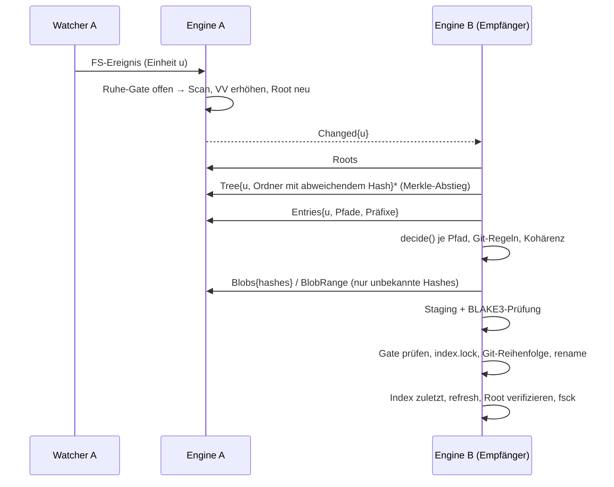

# RepoSync – Implementierungsplan MVP (v0.1)

Stand: 20.10.2026 · Grundlage: [`concept.md`](concept.md)

Dieses Dokument bewertet das Konzept, legt den Umfang des MVP fest, beschreibt
die Architektur der Umsetzung und definiert Meilensteine mit prüfbaren Gates.
Alle bewussten Abweichungen vom Konzept sind als
[Architecture Decision Records](adr/) begründet.

---

## 1. Bewertung des Konzepts

### 1.1 Was trägt

| Prinzip | Bewertung |
| --- | --- |
| Repo = Transaktion | Richtig und der eigentliche Mehrwert gegenüber Syncthing/rsync. Echte Atomarität über viele Dateien gibt es im Dateisystem nicht; das Konzept löst das korrekt über **Reihenfolge + `index.lock` + Staging + Journal**. |
| Erst Ruhe, dann Snapshot | Notwendig. Lock-Dateien und Mehrschritt-Operationen sind zuverlässige, billige Signale. |
| Inhaltsadressierung + Merkle | Ermöglicht Leerlauf-Vergleich in O(1) und gezielten Abstieg; zusätzlich lokale Deduplizierung. |
| Git-Reihenfolge | Objekte → Refs → HEAD → Arbeitsbaum → Index entspricht exakt der Schreibreihenfolge von Git selbst. |
| Versionsvektoren statt Uhren | Korrekt; einzig sichere Grundlage für Konflikterkennung ohne Uhrensynchronisation. |
| Nie stille Datenverluste | Durch Konfliktspeicher + Papierkorb + Tombstones vollständig umsetzbar. |

### 1.2 Lücken und Präzisierungen (vom MVP gelöst)

1. **`.git/index` erzeugt Schein-Drift.** Der Index enthält maschinenspezifische
   Stat-Daten; `git status` und `update-index --refresh` ändern die Bytes ohne
   inhaltliche Änderung. Würde der Index rein über den Byte-Hash verglichen,
   entstünde nach jeder Anwendung auf der Gegenseite eine neue Version →
   Ping-Pong und Scheinkonflikte. **Lösung:** Jeder Eintrag hat zwei Hashes –
   `blob` (Bytes, für Transfer/Verifikation) und `cmp` (Vergleichswert, geht in
   Merkle-Baum und Versionsvektor-Erhöhung ein). Für den Index ist `cmp` ein
   *semantischer Hash* über Modus, Objekt-ID, Stage-Flags und Pfad aller
   Einträge (eigener Parser für Index v2–v4). Stat-only-Änderungen erhöhen den
   Versionsvektor nicht und werden nicht übertragen.
2. **GC und Objekt-Löschungen.** „Objekte nie löschen“ lässt die Merkle-Roots
   nach einem `git gc` dauerhaft divergieren (ewige Drift). **Lösung:**
   Objekt-Löschungen werden übernommen, wenn (a) der Tombstone den lokalen Stand
   per Versionsvektor dominiert, (b) im selben Repo kein Git-Zustands-Konflikt
   besteht und (c) sie als *allerletzter* Schritt nach den neuen Packfiles
   erfolgen. Gelöschte Objekte landen im Papierkorb; schlägt die anschliessende
   `git fsck --connectivity-only`-Prüfung fehl, werden sie automatisch
   zurückgelegt.
3. **Flüchtige Git-Dateien** (`FETCH_HEAD`, `ORIG_HEAD`, `COMMIT_EDITMSG`,
   `objects/info/packs` …) würden bei nebenläufiger Änderung als Konflikt
   gemeldet, obwohl sie belanglos sind. **Lösung:** deterministischer
   Tie-Break (grösserer Zustands-Hash gewinnt) – beide Seiten entscheiden
   identisch und konvergieren ohne Nutzerinteraktion.
4. **Reflogs** werden bei Nebenläufigkeit zeilenweise vereinigt (nach
   Zeitstempel sortiert, Duplikate entfernt), wie im Konzept als Option
   genannt.
5. **Löschung einer ganzen Einheit** braucht einen Eintrag für die Wurzel der
   Einheit selbst. **Lösung:** Jede Einheit hat einen Wurzel-Eintrag mit Pfad
   `""`; wird der Ordner gelöscht, entsteht ein Tombstone dafür.
6. **Staging auf demselben Volume.** Atomares `rename()` funktioniert nur
   innerhalb eines Dateisystems. `~/Library/Application Support` liegt nicht
   zwingend auf dem Volume des Wurzelverzeichnisses. **Lösung:** Staging und
   Papierkorb liegen unter `<root>/.reposync/` (vom Scan ausgeschlossen);
   Datenbank, Schlüssel und Konfliktspeicher im State-Verzeichnis.
7. **Dateien direkt im Wurzelverzeichnis** sind im Konzept keiner Einheit
   zugeordnet. **Lösung:** eigene Einheit `.` (nicht rekursiv).
8. **Pull statt Push.** Die Entscheidung, ob ein Eintrag übernommen wird, kann
   nur die Seite treffen, die den lokalen Zustand kennt. Der MVP verwendet daher
   ein **empfängergesteuertes** Protokoll: Die Quelle meldet nur
   „Einheit X geändert“, der Empfänger vergleicht Roots, steigt in den
   Merkle-Baum ab, entscheidet und fordert Inhalte an. Das ist äquivalent zu
   Announce/Reconcile/Have-Want, aber mit weniger Zustand auf der Quellseite.

### 1.3 Bewusste Vereinfachungen gegenüber dem Konzept (siehe ADRs)

| Konzept | MVP | Begründung |
| --- | --- | --- |
| QUIC (`quinn`) + Raw Public Keys | TCP + Noise `XX_25519_ChaChaPoly_BLAKE2s` (`snow`) mit gepinnten Schlüsseln | [ADR-0002](adr/0002-transport-noise-over-tcp.md) |
| `tokio` | Threads + blockierendes I/O | [ADR-0003](adr/0003-threads-statt-async.md) |
| FSEvents direkt mit Event-ID-Replay | `notify` (FSEvents auf macOS, inotify auf Linux) + Anti-Entropie-Scan nach Start | [ADR-0004](adr/0004-watcher-notify.md) |
| Einfrieren per `clonefile()` | Optimistischer Snapshot: Manifest beim Ruhe-Gate, Inhalte beim Lesen gegen Hash verifiziert, Transaktion bei Abweichung verworfen | [ADR-0005](adr/0005-optimistischer-snapshot.md) |
| Private Key im Schlüsselbund | Datei `identity.key` (0600) im State-Verzeichnis | [ADR-0006](adr/0006-pairing-spake2.md) |
| SwiftUI-Menüleiste | CLI + JSON-IPC-Socket (Menüleiste setzt später darauf auf) | Roadmap |
| FastCDC für grosse Dateien | ganze Dateien, 4-MB-Bereichs-Streaming, Dedup per Hash | Roadmap |
| Übergabe-Modus | nicht im MVP (Zweiweg + Spiegel-Modi vorhanden) | Roadmap |

---

## 2. Umfang des MVP

### 2.1 Enthalten

- **Einheiten:** Git-Einheiten (`.git`-Ordner oder -Datei), Ordner-Einheiten,
  verschachtelte Repos als eigene Einheiten, Root-Einheit `.`; Typwechsel
  Ordner ↔ Git ohne Verlust der Versionsvektoren.
- **Dateisystemobjekte:** reguläre Dateien, Ordner (auch leere), Symlinks (nie
  gefolgt, auch tote), Hardlink-Gruppen innerhalb einer Einheit, Modus,
  `mtime`, Extended Attributes (inkl. Resource Fork/Finder-Info auf macOS),
  BSD-Flags auf macOS. FIFOs, Sockets, Gerätedateien werden übersprungen und
  im Journal gemeldet.
- **Änderungserkennung:** Watcher, Stat-Cache in SQLite, Hashing nur bei
  Metadatenänderung, Echo-Unterdrückung über den Index.
- **Ruhe-Gate:** Git-Locks, Mehrschritt-Operationen, laufende `git`-Prozesse,
  adaptive Ruhezeit (400 ms … 5 s), Höchstwartezeit.
- **Datenmodell:** BLAKE3, Merkle-Baum je Einheit, Versionsvektoren,
  Tombstones (30 Tage, Bereinigung nur bei Gleichstand).
- **Protokoll:** Roots → Merkle-Abstieg → Einträge → Inhalte, Bündelung
  kleiner Dateien (≤ 8 MB pro Anfrage), zstd-Kompression, Bereichs-Transfer
  grosser Dateien, lokale Deduplizierung (Reflink/`clonefile` wo möglich).
- **Atomare Anwendung:** Staging, Hash-Verifikation, Git-Reihenfolge,
  eigenes `index.lock`, Index zuletzt per `rename`, `update-index --refresh`,
  Root-Verifikation, optional `fsck --connectivity-only`, Papierkorb,
  Transaktionsjournal mit Wiederherstellung nach Absturz.
- **Konflikte:** alle Klassen des Konzepts inkl. Kohärenz-Regel für den
  Git-Zustand, Case-Kollision, Ändern-vs-Löschen; Konfliktspeicher ausserhalb
  des Repos; Auflösung `local | remote | both`.
- **Betriebsmodi:** Zweiweg, Spiegel-Sender, Spiegel-Empfänger; pro Einheit
  Pause und Richtungsvorgabe („dieser Mac gewinnt“).
- **Netzwerk:** Pairing mit 6-stelligem Code über SPAKE2, gepinnte
  X25519-Schlüssel, Noise-verschlüsselter Transport, LAN-only-Erzwingung,
  Bonjour/mDNS-Discovery mit manuellem Fallback.
- **Bedienung:** CLI (`init`, `pair`, `daemon`, `status`, `diff`, `sync
  [--dry-run]`, `verify`, `conflicts`, `resolve`, `log`, `pause`, `resume`,
  `prefer`, `trash`, `restore`, `service`), Journal mit JSON-Export,
  LaunchAgent-Erzeugung.

### 2.2 Nicht enthalten (Roadmap v0.2+)

Menüleisten-App, Übergabe-Modus, FastCDC-Delta, QUIC-Mehrwege, Keychain,
Erkennung geöffneter SQLite-Datenbanken/Bundles als atomare Gruppe,
Sparse-File-Erhaltung, `birthtime`, ACLs, iCloud-Platzhalter-Erkennung
jenseits des `SF_DATALESS`-Flags, Hot-Reload der Konfiguration,
GC-Koordination per `gc.auto=0`.

---

## 3. Architektur

### 3.1 Cargo-Workspace

```text
crates/
  core/      reposync-core      reines Datenmodell: Hash, Entry, VersionVector,
                                Merkle-Baum, Entscheidungslogik, Git-Pfadklassen,
                                Protokoll-Nachrichten. Kein I/O → proptest.
  fs/        reposync-fs        Scan, Hashing, xattrs, Flags, Ausschlüsse,
                                Einheiten-Erkennung, Staging, Papierkorb,
                                atomare Dateioperationen, Case-Probe.
  gitaware/  reposync-gitaware  Ruhe-Gate (Locks, Operationen, Prozesse),
                                semantischer Index-Hash, Reflog-Merge,
                                update-index/fsck.
  store/     reposync-store     SQLite (WAL): units, entries, tx, journal,
                                conflicts, peers, kv.
  engine/    reposync-engine    Scan→Index, Bedienung von Anfragen, Pull,
                                Planung, atomare Anwendung, Wiederherstellung,
                                Konfliktauflösung. `PeerApi`-Trait.
  net/       reposync-net       Noise-Transport, Framing, Kompression,
                                Pairing (SPAKE2), Client (`NetPeer`) und Server,
                                LAN-Prüfung, mDNS.
  daemon/    reposync-daemon    Konfiguration, Watcher, Scheduler, IPC-Server.
  cli/       reposync-cli       Binary `reposync`.
tests/e2e/   Skripte: zwei Daemons auf Loopback, Git-Torture-Test.
```

Abhängigkeiten sind azyklisch: `core` ← `fs`, `gitaware` ← `store` ← `engine`
← `net` ← `daemon` ← `cli`.

### 3.2 Datenfluss einer Synchronisierungsrunde



### 3.3 Entscheidungsmatrix (`core::decide`)

| Lokal | Remote | Ergebnis |
| --- | --- | --- |
| – | beliebig | übernehmen |
| VV gleich, Zustand gleich | | nichts |
| | dominiert, Zustand gleich | nur VV übernehmen |
| | dominiert | übernehmen (alter Stand → Papierkorb) |
| dominiert | | lokal behalten (Gegenseite zieht) |
| nebenläufig, Zustand gleich | | VVs vereinigen |
| nebenläufig, lokal gelöscht | geändert | Änderung übernehmen |
| nebenläufig, lokal geändert | gelöscht | lokal behalten, VV vereinigen + erhöhen |
| nebenläufig, beide geändert | | Konflikt (Richtungsvorgabe kann auflösen) |

Git-Overlay: Objekte und flüchtige Dateien per Tie-Break, Reflogs per Merge,
`HEAD`/Refs/`packed-refs`/Index bilden eine Kohärenzgruppe – ein Konflikt in
der Gruppe hält die gesamte Gruppe zurück (ein Konflikt-Eintrag).

### 3.4 Anwendungsreihenfolge

1. Ordner anlegen (flach → tief)
2. Loose Objects → `.pack` → `.idx` → `.rev/.bitmap/…` → übrige `objects/`
3. `packed-refs` → `refs/**` → `logs/**`
4. `HEAD` und übrige `.git`-Metadaten
5. Arbeitsbaum (Schreiben)
6. Löschungen (tief → flach), ohne Objekte
7. `index` über das eigene `index.lock`
8. Objekt-Löschungen (nur sicher, s. 1.2)
9. `update-index --refresh -q`, Root-Verifikation, `fsck`

---

## 4. Meilensteine und Gates

| # | Meilenstein | Inhalt | Gate (automatisiert geprüft) |
| --- | --- | --- | --- |
| M0 | Dokumentation & Gerüst | Konzept, Plan, ADRs, Workspace, CI | `cargo build`, CI grün |
| M1 | Core | Hash, Entry, VV, Merkle, decide, Git-Pfadklassen | proptest: VV-Halbordnung, Merkle-Determinismus, Konvergenz-Simulation |
| M2 | Dateisystem & Store | Scan, Stat-Cache, xattrs, Einheiten, SQLite | Scan-Tests: Typen, Echo-Freiheit, Typwechsel |
| M3 | Git-bewusst | Gate, Index-Hash, Reflog-Merge | Tests gegen echte Repos (Locks, Rebase, Stat-only) |
| M4 | Engine | Pull, Plan, atomare Anwendung, Konflikte, Recovery | In-Prozess-Zwei-Peer-Tests inkl. `git fsck`, Crash-Injektion |
| M5 | Netzwerk | Noise, Pairing, Server/Client, LAN-Prüfung | Loopback-Tests: Pairing, falscher Code, fremder Schlüssel |
| M6 | Daemon & CLI | Watcher, Scheduler, IPC, alle Befehle | E2E: zwei Daemons, Latenz < 3 s |
| M7 | Validierung | Torture-Test, Benchmarks, Validierungsbericht | `docs/validation-report.md` |

---

## 5. Teststrategie (MVP-Ausprägung)

- **Unit + Property-Tests** (`core`): VV-Vergleich ist eine Halbordnung,
  `merge` ist kommutativ/assoziativ/idempotent; `decide` ist symmetrisch
  (beide Seiten erreichen bei nebenläufigen identischen Änderungen Konvergenz);
  zufällige Änderungsfolgen auf zwei simulierten Seiten konvergieren nach
  beidseitigem Abgleich, ohne dass je eine Version ohne Konflikteintrag
  verloren geht.
- **Integrationstests** (`engine`): zwei Wurzelverzeichnisse in temporären
  Ordnern, zwei Engines, In-Prozess-Peer – deterministisch, ohne Netzwerk.
  Prüfungen: Roots gleich, Dateiinhalte gleich, `git fsck --full` und
  `git status` sauber, keine Commits/Refs durch das Tool (Ref-Liste vorher =
  nachher auf der Quelle).
- **Crash-Tests:** Fehlerinjektion nach *n* Operationen, anschliessend
  Wiederherstellung → Zustand ist alt oder neu, `fsck`-gültig.
- **Netzwerktests:** Pairing über Loopback, Ablehnung falscher Codes und
  ungepairter Schlüssel, vollständige Synchronisierung über TCP/Noise.
- **E2E/Torture:** zwei Daemon-Prozesse, Skript mit `commit`, `checkout`,
  `stash`, `rebase`, `gc`, vielen kleinen Dateien; danach `verify`.

## 6. Definition of Done

- `cargo fmt --check`, `cargo clippy -D warnings`, `cargo test` grün
  (Linux; macOS in CI).
- Alle Gates M0–M7 erfüllt und im [Validierungsbericht](validation-report.md)
  mit Messwerten belegt.
- README mit Schnellstart, Architektur- und Betriebsdokumentation.

## 7. Entscheidungen zu den offenen Fragen des Konzepts

| Frage | MVP-Annahme | Konfigurierbar |
| --- | --- | --- |
| Gleichzeitige Arbeit? | Zweiweg als Standard, Konflikte sicher erkannt | `mode` |
| Gleiche CPU-Architektur? | Warnung beim Pairing bei Unterschied | – |
| Gleicher Benutzer/Pfad? | Warnung beim Pairing bei Unterschied | – |
| Grösse | Ziel ≥ 100 000 Dateien pro Einheit | – |
| LFS/Submodule/Worktrees | `.git`-Datei wird erkannt; Submodul-Gitdirs gehören zur Eltern-Einheit; LFS-Objekte sind normale Dateien unter `.git/lfs` | – |
| Mitteilungen | Journal + `status`; Mitteilungen mit Menüleiste (Roadmap) | – |
